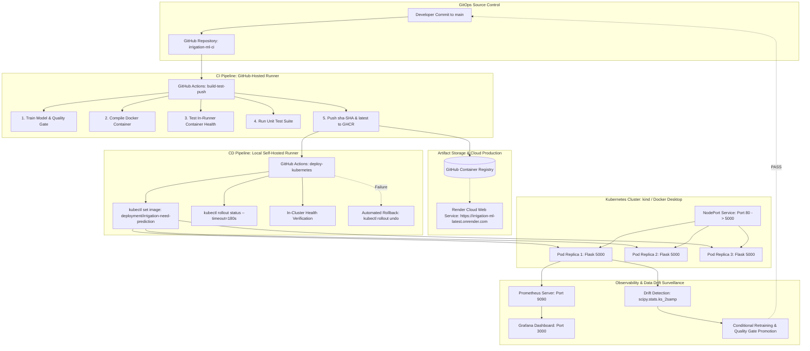

# 🌾 Irrigation Need Prediction — Enterprise MLOps Pipeline

[](https://github.com/BhanuTeja33/irrigation-ml-ci/actions)
[](https://github.com/BhanuTeja33/irrigation-ml-ci/actions/workflows/kubernetes-cicd.yml)
[](https://irrigation-ml-latest.onrender.com)
[](https://github.com/users/BhanuTeja33/packages/container/package/irrigation-ml)
[](https://kubernetes.io)
[](http://localhost:3000)
[](https://www.python.org/)

An enterprise-grade, end-to-end Machine Learning Operations (MLOps) system designed for precision agriculture. The system ingests field soil telemetry and atmospheric weather forecasts to deliver real-time irrigation recommendations (`IRRIGATE` [1] vs. `SKIP` [0]), optimizing water resource utilization while safeguarding crop yields.

---

## 📑 Complete Laboratory Curriculum & Deliverables (Practicals 2 – 15)

All practical assignments have been implemented, tested, and documented with actual execution screenshots in Microsoft Word (`.docx`) format, stored in [`Practical_Word_Documents/`](Practical_Word_Documents/):

| Practical | Document Link | Core Topics & Technologies | Status |
| :---: | :--- | :--- | :---: |
| **P2** | [PRACTICAL-2_Irrigation_ML_CI.docx](Practical_Word_Documents/PRACTICAL-2_Irrigation_ML_CI.docx) | Automated model training pipeline, feature scaling (`StandardScaler`), unit testing in GitHub Actions CI. | ✅ Complete |
| **P3** | [PRACTICAL-3_Irrigation_Quality_Gate.docx](Practical_Word_Documents/PRACTICAL-3_Irrigation_Quality_Gate.docx) | Machine Learning Quality Gate enforcing minimum accuracy thresholds ($\ge 90.0\%$) before candidate release. | ✅ Complete |
| **P4** | [PRACTICAL-4_Preserving_Irrigation_Artifacts.docx](Practical_Word_Documents/PRACTICAL-4_Preserving_Irrigation_Artifacts.docx) | Automated artifact retention (`irrigation_model.pkl`, `metrics.json`) via `actions/upload-artifact@v4`. | ✅ Complete |
| **P5** | [PRACTICAL-5_Continuous_Delivery_Irrigation_App.docx](Practical_Word_Documents/PRACTICAL-5_Continuous_Delivery_Irrigation_App.docx) | Continuous Delivery packaging and Flask REST microservice (`app.py`) with root health and inference routes. | ✅ Complete |
| **P6** | [PRACTICAL-6_Dockerize_Irrigation_App.docx](Practical_Word_Documents/PRACTICAL-6_Dockerize_Irrigation_App.docx) | Application containerization via `python:3.11-slim`, Docker build, port forwarding (`5000:5000`), container verification. | ✅ Complete |
| **P7** | [PRACTICAL-7_Automate_Docker_Build_and_Test.docx](Practical_Word_Documents/PRACTICAL-7_Automate_Docker_Build_and_Test.docx) | Automated container compilation, health polling, and live endpoint smoke tests inside GitHub Actions. | ✅ Complete |
| **P8** | [PRACTICAL-8_Publish_Docker_Image_to_GHCR.docx](Practical_Word_Documents/PRACTICAL-8_Publish_Docker_Image_to_GHCR.docx) | Container publication to GitHub Container Registry (`ghcr.io/bhanuteja33/irrigation-ml:v1` and `:latest`). | ✅ Complete |
| **P9** | [PRACTICAL-9_Irrigation_ML_GHCR_Final.docx](Practical_Word_Documents/PRACTICAL-9_Irrigation_ML_GHCR_Final.docx) | Full automated CI/CD pipeline building, testing, tagging, and pushing container images to GHCR on `main` push. | ✅ Complete |
| **P10** | [PRACTICAL-10_Deploy_GHCR_Image_to_Render_Final.docx](Practical_Word_Documents/PRACTICAL-10_Deploy_GHCR_Image_to_Render_Final.docx) | Image-backed cloud production deployment on Render Web Service, port routing (`PORT=5000`), public HTTPS verification. | ✅ Complete |
| **P11** | [PRACTICAL-11_Implement_Logging_and_Error_Tracking_Final.docx](Practical_Word_Documents/PRACTICAL-11_Implement_Logging_and_Error_Tracking_Final.docx) | Structured stdout logging, UUID request tracking (`X-Request-ID`), response duration, error handling (200, 400, 404). | ✅ Complete |
| **P12** | [PRACTICAL-12_Monitor_API_Prometheus_Grafana_Final.docx](Practical_Word_Documents/PRACTICAL-12_Monitor_API_Prometheus_Grafana_Final.docx) | Numerical metric instrumentation (`/metrics`), Prometheus scraping (15s), Grafana 4-panel dashboard, alert rules. | ✅ Complete |
| **P13** | [PRACTICAL-13_Deploy_and_Scale_Kubernetes_Final.docx](Practical_Word_Documents/PRACTICAL-13_Deploy_and_Scale_Kubernetes_Final.docx) | Local Kubernetes orchestration, NodePort service, liveness/readiness probes, 3-replica scaling, self-healing, rolling updates, rollback. | ✅ Complete |
| **P14** | [PRACTICAL-14_Automate_Kubernetes_Deployment_Final.docx](Practical_Word_Documents/PRACTICAL-14_Automate_Kubernetes_Deployment_Final.docx) | GitOps automated continuous deployment: GitHub-hosted CI + self-hosted runner CD, immutable SHA tagging, automated rollback. | ✅ Complete |
| **P15** | [PRACTICAL-15_Detect_Data_Drift_and_Retrain_Model_Final.docx](Practical_Word_Documents/PRACTICAL-15_Detect_Data_Drift_and_Retrain_Model_Final.docx) | Two-sample Kolmogorov-Smirnov (KS) statistical drift testing, conditional retraining, candidate quality gate ($\ge 85\%$). | ✅ Complete |

---

## 🏛️ End-to-End System Architecture



---

## ⚙️ Feature Schema & Inference Contract

The model predicts binary agricultural decisions based on 4 telemetry variables:

| Feature Name | Type | Unit | Range | Description |
| :--- | :---: | :---: | :---: | :--- |
| `soil_moisture` | Float / Int | % | 5.0 – 95.0 | Volumetric soil water content |
| `temperature` | Float / Int | °C | 5.0 – 55.0 | Ambient field canopy temperature |
| `humidity` | Float / Int | % | 10.0 – 100.0 | Relative atmospheric humidity |
| `rainfall_forecast_mm` | Float / Int | mm | 0.0 – 100.0 | Expected precipitation in next 24 hours |

### Target Decision:
- **`IRRIGATE` (Code `1`)**: Soil moisture deficit detected; immediate watering required.
- **`SKIP` (Code `0`)**: Adequate moisture or upcoming rainfall forecast; conserve water.

---

## 🚀 Quick Execution Guide

### 1. Local Python Environment
```powershell
# Navigate to project directory
cd "C:\Users\velpu\OneDrive\Desktop\mlops project"

# Install dependencies
pip install -r requirements.txt

# Train model & evaluate quality gate
python train_irrigation_model.py
python irrigation_quality_gate.py

# Run unit test suite
python -m unittest test_app.py test_irrigation_ml.py

# Start local API server
python app.py
```

### 2. Docker Containerized Serving
```powershell
# Build Docker image
docker build -t irrigation-ml:latest .

# Run container
docker run -d --name irrigation-app -p 5000:5000 irrigation-ml:latest

# Verify Health Check
curl.exe http://localhost:5000/

# Test Prediction Inference
Invoke-RestMethod -Uri "http://localhost:5000/predict" `
  -Method Post `
  -Body '{"soil_moisture":15,"temperature":40,"humidity":30,"rainfall_forecast_mm":0}' `
  -ContentType "application/json"
```

### 3. Kubernetes Deployment & Scaling
```powershell
# Apply Kubernetes manifests
kubectl apply -f Practical_13_Kubernetes/deployment.yaml
kubectl apply -f Practical_13_Kubernetes/service.yaml

# Scale to 3 replicas
kubectl scale deployment irrigation-need-prediction --replicas=3

# Port-forward service to local port 8080
kubectl port-forward service/irrigation-need-prediction-service 8080:80
```

### 4. Data Drift Surveillance & Retraining
```powershell
# Generate baseline reference
python drift/prepare_reference.py

# Test stable monitoring batch (0 flagged features)
python drift/simulate_current_data.py --mode stable
python drift/detect_drift.py
python drift/retrain_candidate.py   # Retraining safely skipped

# Simulate environmental drought drift (4 flagged features)
python drift/simulate_current_data.py --mode drift
python drift/detect_drift.py         # Flags overall drift

# Retrain candidate model & evaluate quality gate
python drift/retrain_candidate.py    # Achieves 85.45% accuracy
python drift/approve_candidate.py    # Promotes model to production
```

---

## 📊 Live Observability & Monitoring Metrics

| Metric Name | Type | Query / PromQL | Description |
| :--- | :---: | :--- | :--- |
| `irrigation_api_http_requests_total` | Counter | `sum(rate(irrigation_api_http_requests_total[1m]))` | Real-time request rate (RPS) |
| `irrigation_api_http_request_duration_seconds` | Histogram | `histogram_quantile(0.95, sum by (le)(rate(...[5m])))` | Tail latency (P95 response time in ms) |
| `irrigation_api_predictions_total` | Counter | `sum(irrigation_api_predictions_total{result="success"})` | Total successful ML inferences |
| `irrigation_api_model_loaded` | Gauge | `irrigation_api_model_loaded` | Model readiness indicator (1=UP, 0=DOWN) |
| `up` | Gauge | `up{job="irrigation-need-api"}` | Prometheus scrape target reachability |

---

## 📂 Project Directory Structure

```text
mlops project/
├── .github/
│   └── workflows/
│       ├── docker-publish.yml          # Automated Docker build, test, and GHCR publishing (P9-P11)
│       ├── irrigation-ml-ci.yml        # Model training, quality gate, and unit tests (P2-P5)
│       └── kubernetes-cicd.yml         # End-to-end cloud-to-local Kubernetes deployment (P14)
├── drift/
│   ├── prepare_reference.py            # Extracts baseline reference from historical training data
│   ├── simulate_current_data.py        # Simulates stable vs. drifted production batches
│   ├── detect_drift.py                 # Two-sample Kolmogorov-Smirnov statistical hypothesis testing
│   ├── retrain_candidate.py            # Conditional retraining on augmented telemetry data
│   └── approve_candidate.py            # Automated quality gate evaluation (>= 85%) and promotion
├── Practical_12_Monitoring/
│   ├── prometheus.yml                  # Prometheus scrape configurations and scrape intervals
│   └── irrigation_api_alerts.yml       # Production alerting rules for downtime and client error spikes
├── Practical_13_Kubernetes/
│   ├── deployment.yaml                 # Declarative Kubernetes deployment with rolling update strategy
│   └── service.yaml                    # NodePort service specification routing to container port 5000
├── Practical_14_Kubernetes_CICD/
│   └── kubernetes-cicd.yml             # Kubernetes continuous delivery workflow specification
├── Practical_Word_Documents/           # Preserved Word (.docx) manuals for Practicals 2 through 15
├── screenshots/                        # Live terminal and platform execution screenshots
├── app.py                              # Flask serving API with logging, Prometheus metrics, and error tracking
├── train_irrigation_model.py           # Model training pipeline (Logistic Regression with StandardScaler)
├── irrigation_quality_gate.py          # Quality gate threshold validation script
├── test_app.py                         # API unit tests for health, prediction, and validation errors
├── test_irrigation_ml.py               # Machine learning unit tests for feature schema and predictions
├── field_data.csv                      # Historical agricultural field telemetry dataset
├── Dockerfile                          # Multi-stage container definition using python:3.11-slim
├── requirements.txt                    # Project dependencies (Flask, scikit-learn, prometheus-client, scipy)
└── README.md                           # Master end-to-end MLOps documentation
```

---

## 👨‍💻 Student Author

- **Student Name**: Bhanu Teja Velpuri
- **GitHub Username**: [@BhanuTeja33](https://github.com/BhanuTeja33)
- **Project Domain**: Precision Agriculture — Irrigation Need Prediction
- **Academic Program**: B.Tech CSE — Machine Learning Operations (MLOps)
- **Repository**: [https://github.com/BhanuTeja33/irrigation-ml-ci](https://github.com/BhanuTeja33/irrigation-ml-ci)
